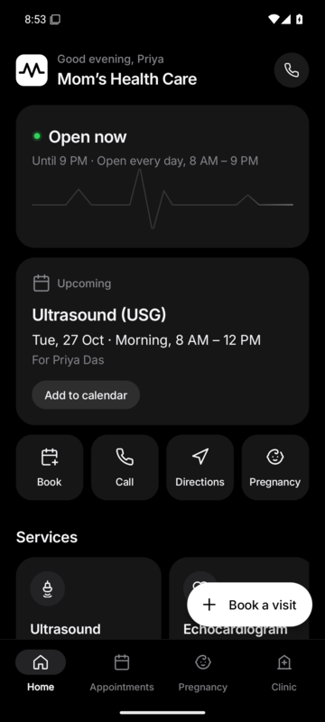
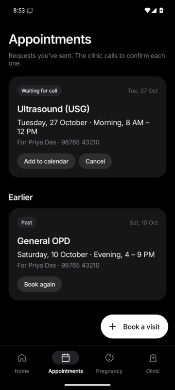
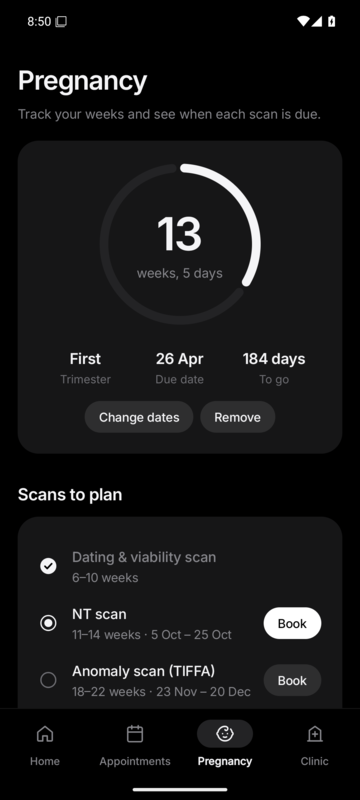
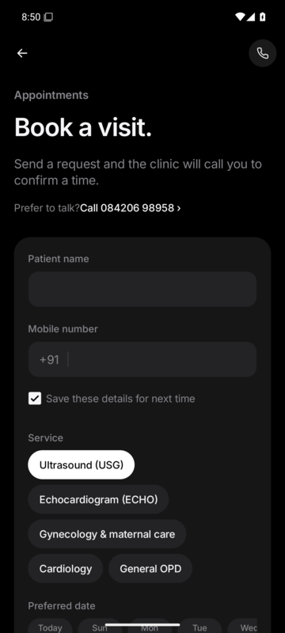
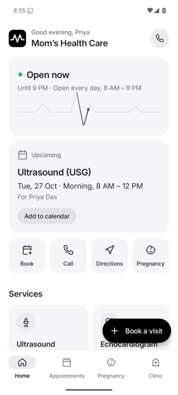
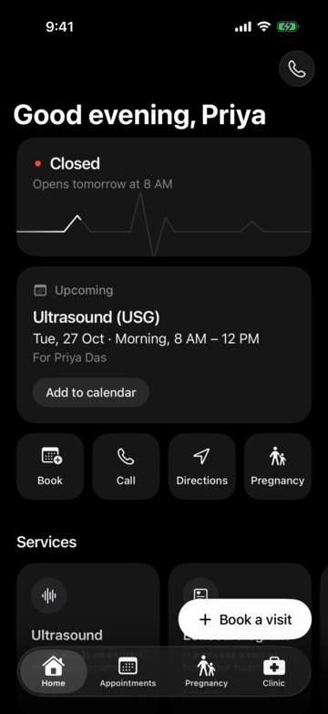
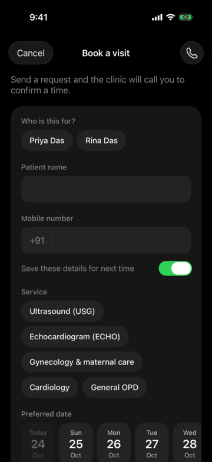

# Mom’s Health Care — Android and Apple apps

Free, open-source apps for [Mom’s Health Care](https://momshealthcare.site.je/), a diagnostic centre
and clinic in Thakurpukur, Kolkata. Same content and black-and-white design as the website, with
appointment booking that reaches the clinic inbox (**drpubalisarkar@gmail.com**).

## Screenshots

Android:

<p>





</p>

iPhone and iPad:

<p>




</p>

## What’s in the app

- **Book a visit**: pick a service, a day and a time; the clinic calls back to confirm.
  Saved patients fill the form in one tap.
- **Appointments**: every request you’ve sent; add one to your calendar, cancel it, or book again.
- **Pregnancy**: enter your last period (or due date) to see your week, due date and when each
  scan is usually done, with a Book button for each.
- **Services**: what each one is and how to prepare.
- **Clinic**: live open/closed status, opening hours, directions, one-tap call, and a 112 emergency button.
- **Appearance**: Dark, Light or Match phone.

Everything stays on the device. Only a booking or cancellation is sent, and only to the clinic.

## Android

- **Download:** `MomsHealthCare.apk` from the [latest release](../../releases/latest). Open it on the
  phone and allow “install unknown apps” once.
- **Runs on** Android 5.0 to Android 16. About 1.8 MB.
- Long-press the app icon for **Book**, **Call clinic** and **Directions** shortcuts.

## iPhone, iPad and Mac

The `ios/` folder is a SwiftUI app for iPhone and iPad (iOS 16 and later). The same app runs on
Apple silicon Macs and Apple Vision Pro as an iPad app. On iPad and Mac it uses a sidebar instead
of tabs.

Apple only allows apps to be installed from the App Store, TestFlight or Xcode, so there is no file
to download here. To run it:

1. On a Mac with Xcode 16 or later, open `ios/MomsHealthCare.xcodeproj`.
2. Choose your iPhone or iPad (or “My Mac (Designed for iPad)”) and press Run. A free Apple ID
   works for your own devices; apps installed this way need re-installing every 7 days.

To publish it on the App Store (free for patients), the clinic needs an Apple Developer account,
then **Product › Archive** in Xcode and upload.

## How booking reaches the doctor

Both apps post to the website’s own FormSubmit form (`formsubmit.co/ajax/drpubalisarkar@gmail.com`),
which is already activated for that inbox. They use the website’s field names (Patient Name, Phone,
Service, Preferred Date, Preferred Time, Notes) plus “Booked via”, so every email looks the same.
If sending fails, the app offers **Try again**, **Use email app** (pre-filled to the doctor) or **Call**.

## Build

Android (JDK 17 and the Android SDK, platform 36):

```
./gradlew assembleRelease   # app/build/outputs/apk/release/app-release.apk
```

Release builds are signed with a key described in `keystore.properties`:

```
storeFile=your-release.jks
storePassword=...
keyAlias=...
keyPassword=...
```

Without that file the release build is signed with the debug key, which is fine for testing.
The official key is never committed; every update published here must be signed with it, or
phones will refuse to install it over the previous version.

Every push to `main` is built by GitHub Actions: an Android debug APK, and the Apple app built and
run on iPhone and iPad simulators, with screenshots saved as build artifacts.

## Code

| Android (`app/src/main/java/…`) | Apple (`ios/MomsHealthCare/`) | What it does |
| --- | --- | --- |
| `MainActivity.kt` | `MomsHealthCareApp.swift` | Tabs / sidebar, Book button |
| `HomeFragment.kt` | `HomeView.swift` | Status, next appointment, quick actions, services |
| `AppointmentsFragment.kt` | `AppointmentsView.swift` | History, calendar, cancel |
| `PregnancyFragment.kt`, `Pregnancy.kt` | `PregnancyView.swift` | Week tracker and scan timeline |
| `ClinicFragment.kt` | `ClinicView.swift` | Hours, services, emergency, settings |
| `BookingActivity.kt` | `BookingView.swift` | Booking form, same rules as the website |
| `BookingSender.kt` | `Sender.swift` | Sends requests to the clinic inbox |
| `Clinic.kt`, `Store.kt` | `Clinic.swift`, `Store.swift` | Clinic data, Kolkata time, saved data |

## Low-end phones

- Plain Android views, no Jetpack Compose and no WebView. Vector icons only.
- R8 shrinking, and Inter fonts trimmed to the Latin set (~50 KB each).
- Looping animations switch off on low-RAM or slow phones, in battery saver, and when animations
  are turned off in system settings (on iPhone: Reduce Motion or Low Power Mode).

## License

The code is released under the [MIT License](LICENSE). The clinic’s name, logo and written
content belong to Mom’s Health Care; if you reuse this app for another clinic, replace them.

Font and icon credits are in [THIRD_PARTY_NOTICES.md](THIRD_PARTY_NOTICES.md).
